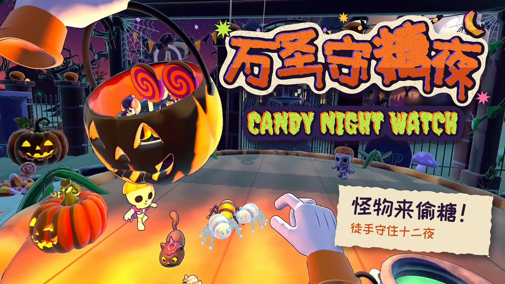

# 万圣守糖夜 Candy Night Watch



一款万圣节主题的 MR 小游戏，不用手柄，只靠眼动和手势操作。

万圣夜，桌上放着一桶糖，骷髅、幽灵、蝙蝠、蜘蛛、南瓜头一夜比一夜多，都想把糖偷走。玩家看着怪物就能锁定它，捏住拎起来丢进坩埚；也可以用手势放技能：双手合十冻住全场、张开手召出南瓜灯、双手外推把怪物吹飞。一共十二夜，每夜按剩下的糖结算星星。

## 运行环境

- Unity **6000.5.5f1**（URP）
- 目标设备：PICO 4 Ultra（需要眼动追踪和手势追踪）
- PICO Unity Integration SDK 6.0.0

### 关于 PICO SDK

`Packages/manifest.json` 里的 PICO SDK 指向作者本机路径：

```
"com.bytedance.pico.xr": "file:/Users/ld/Library/PICO/UnitySDK/6.0.0/PICO-Unity-SDK/XR"
```

克隆后请先从 PICO 开发者平台下载 SDK，再把这一行改成你自己的路径，否则工程打不开这个包。

## 打开工程

1. 用 Unity Hub 添加本目录，编辑器选 6000.5.5f1。
2. 主场景是 `Assets/_Game/Scenes/Main.unity`。
3. 改了玩法数据或文案后，执行菜单 `Tools/TrickOrFreeze/Rebuild Gameplay (keep scene)`。它会同步本地化文本，并重新烘焙防穿模用的体素网格。

## 打包

菜单 `Tools/TrickOrFreeze/Android 2 - Build APK`，或者用命令行：

```
Unity -batchmode -projectPath . -executeMethod TrickOrFreeze.EditorTools.AndroidBuild.BatchBuild -quit
```

签名密钥库**没有放进仓库**。打包前需要自己生成一个，放到 `Keystore/trickorfreeze.keystore`，并把密码写进 `Keystore/keystore_pass.txt`。

## 目录

| 路径 | 内容 |
|---|---|
| `Assets/_Game/Scripts/Core` | 纯玩法逻辑（不依赖 Unity 场景，可单测） |
| `Assets/_Game/Scripts/Runtime` | 输入、表现、界面 |
| `Assets/_Game/Scripts/Editor` | 场景搭建、打包、防穿模烘焙等编辑器工具 |
| `Assets/_Game/Tests/EditMode` | 编辑模式测试 |
| `Assets/_Game/Localization` | 中英文文本 |
| `Tools/` | 美术处理、字体子集化等 Python / Blender 脚本 |
| `Docs/` | 设计文档 |

美术源文件（概念图、Blender 源文件等）体积较大，没有放进仓库，打开和运行工程不需要它们。

## 素材来源

- 背景音乐：全部为 CC0 或公有领域录音，来源和许可见 `Assets/_Game/Audio/CREDITS.md`。
- 字体：站酷快乐体（ZCOOL KuaiLe）、Baloo 2、Creepster，均为 SIL Open Font License。
- 音效：部分为本项目离线合成，部分来自素材库，来源链接同样列在 `CREDITS.md`。素材库音效的授权条款未逐一核实，如需复用请自行确认。
